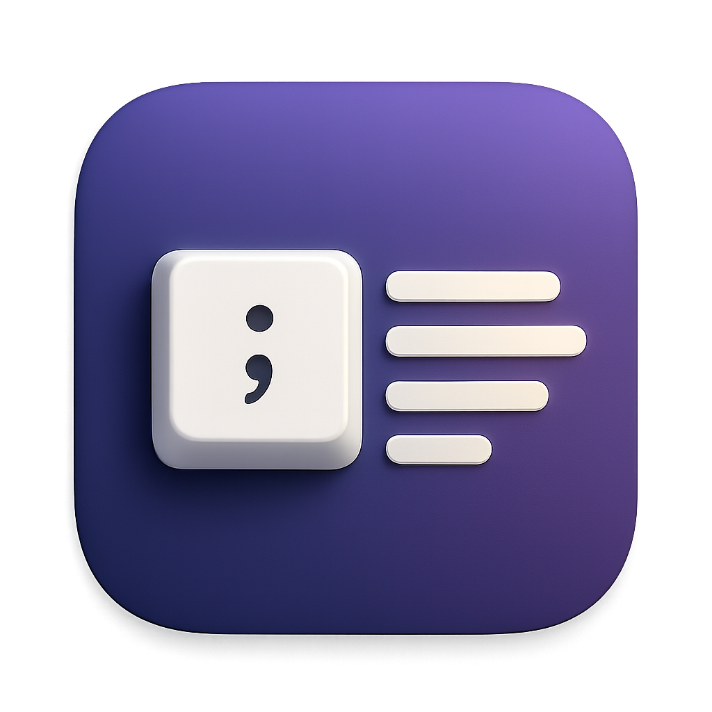

# Shorthand

A menu-bar text expander for macOS 14 and later. Type an abbreviation like `;sig` anywhere
and it becomes your full text. Type `;;` to search a bank of prompts you reuse often.



## What it does

- **Snippets:** an abbreviation is replaced with its text as soon as you finish typing it.
- **Templates:**
  - `{date}`, `{time}`, `{isodate}`, `{clipboard}`, `{cursor}` and your saved variables
    (like `{company}`) fill in automatically.
  - Any other `{Name}` is asked for in a small form when you insert the snippet.
- **Prompt Bank:** snippets with no abbreviation. Type `;;` anywhere for a searchable
  launcher, or pick one from the menu bar.

The [changelog](CHANGELOG.md) covers every feature.

## Install

1. Download `Shorthand-<version>.zip` from the
   [releases](https://github.com/LucasVilela/shorthand/releases), unzip it, and move
   `Shorthand.app` to `/Applications`.
2. Open it. Releases aren't notarized yet, so on a Mac other than the one that built it,
   macOS may refuse at first. To allow it, go to System Settings → Privacy & Security and
   click **Open Anyway**.
3. When asked, turn Shorthand on under System Settings → Privacy & Security →
   **Accessibility**. It needs this to see what you type and to paste snippets.

Snippets and variables are saved in `~/Library/Application Support/Shorthand/`.

## Build from source

You need Xcode 26 (Swift 6). There is no Xcode project; it's a Swift package.

```bash
swift test                  # run the tests
./scripts/build-app.sh      # build and sign build/Shorthand.app
open build/Shorthand.app
```

`build-app.sh` signs with a Developer ID certificate if you have one, otherwise with an Apple
Development certificate. The signature matters: macOS remembers the Accessibility permission
per signature, so with a stable certificate it survives rebuilds. With no certificate the app
is ad-hoc signed, and you'll need to turn Accessibility on again after every build.

Code layout:

- `Sources/ShorthandCore`: the logic, which is unit tested. It covers abbreviation matching,
  templates and fill-ins, variables, and Prompt Bank search.
- `Sources/Shorthand`: the app. It has the keystroke monitor (a Core Graphics event tap), the
  expander (backspaces, paste, clipboard restore), the panels and the editor.

## Releasing

1. Set the version in `Resources/Info.plist` (`CFBundleShortVersionString`, and bump
   `CFBundleVersion`).
2. Add a `## <version> — <date>` section to `CHANGELOG.md` and commit.
3. Run `./scripts/release.sh --publish`. It does the following:
   - runs the tests and builds the app
   - checks the signature
   - zips the app and writes its SHA-256
   - notarizes the zip, if set up (see below)
   - tags `v<version>`, pushes the tag, and creates the GitHub release with the changelog
     section as its notes

Run it without `--publish` to only build the zip in `build/`.

### Notarization (once)

Notarized apps open on any Mac without a warning. You need a **Developer ID Application**
certificate: create it in Xcode → Settings → Accounts → Manage Certificates. Then store
credentials for `notarytool` once:

```bash
xcrun notarytool store-credentials shorthand-notary --apple-id <apple-id> --team-id <team-id>
```

From then on, release with `NOTARY_PROFILE=shorthand-notary ./scripts/release.sh --publish`.

## Licence

Private. All rights reserved, see [LICENSE](LICENSE).
